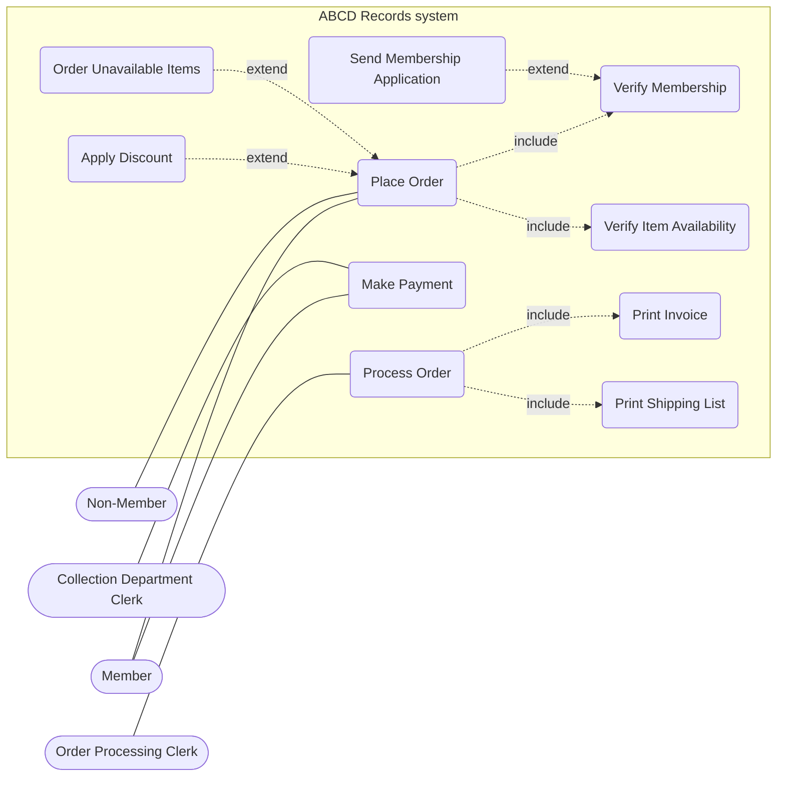
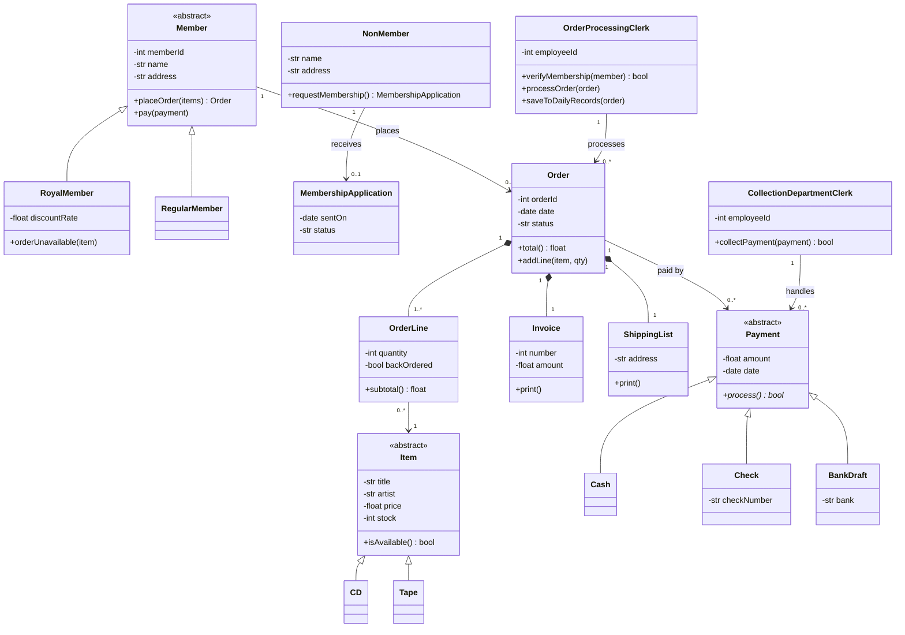
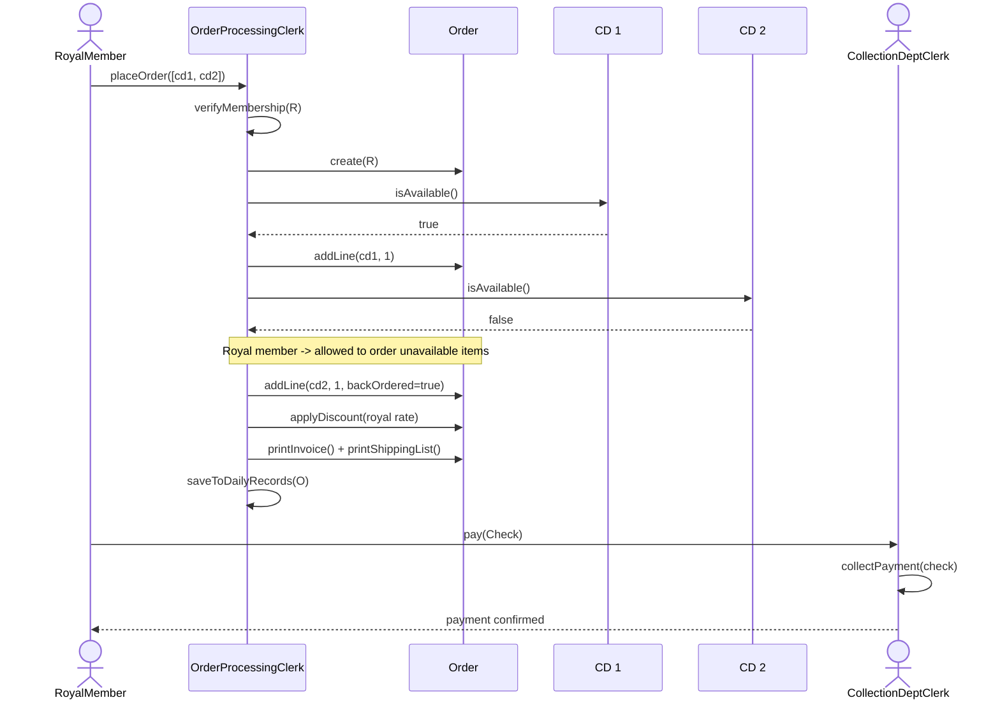

# Exo 2 - ABCD Records

## Use case diagram

(mermaid has no real use case diagram so I used a flowchart: rounded boxes = use cases)

- `Verify Membership` and `Verify Item Availability` always happen when an order is placed -> include
- `Apply Discount` and `Order Unavailable Items` only for Royal members -> extend
- `Send Membership Application` only when the membership check fails (non-member) -> extend

## Class diagram

## Sequence diagram - Royal member orders 2 CDs (one unavailable), pays by check

